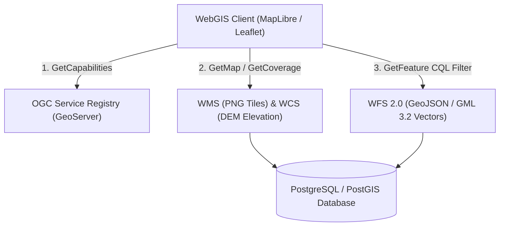
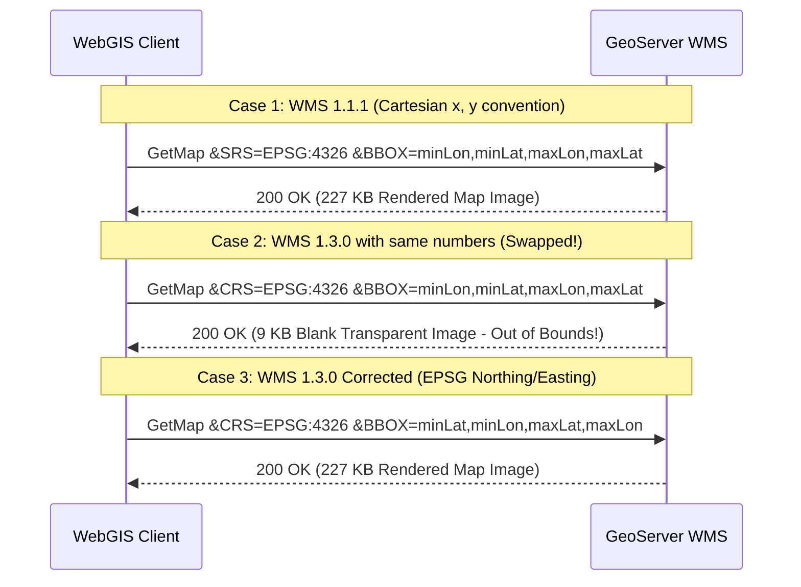

# Study Note S1: OGC Protocols, Coordinate Reference Systems, and Map Projection Mathematics

**Author:** VibePune WebGIS Engineering Team  
**Module:** Spatial Standards, Cartographic Foundations & OGC Services  
**Project:** VibePune (PMC + PCMC Study Area)

---

## 1. Executive Overview

Spatial data interoperability depends upon shared computational specifications and rigorous mathematical modeling of the Earth's non-Euclidean geometry. This study note examines the architectural mechanisms of Open Geospatial Consortium (OGC) web protocols (**WMS**, **WFS**, and **WCS**), the geodetic distinctions between **Geographic**, **Projected**, and **Spherical Web Mercator** coordinate reference systems, the infamous **axis-order transition** between WMS 1.1.1 and 1.3.0, and the differential calculus governing **Mercator area inflation** with empirical evidence from Pune, India.

---

## 2. OGC Web Services Architecture

The Open Geospatial Consortium (OGC) establishes open consensus standards for publishing, exchanging, and querying geospatial data across heterogeneous distributed networks.

### 2.1 Web Map Service (WMS)
- **Primary Function:** Server-side dynamic rendering of vector and raster geospatial datasets into georeferenced raster image tiles (typically PNG or JPEG).
- **Core Operations:**
  - `GetCapabilities`: Dispatches service metadata, supported coordinate reference systems, bounding boxes, and published layer hierarchies in XML format.
  - `GetMap`: Returns a rasterized map graphic for a requested geographic bounding box (`BBOX`), dimensions (`WIDTH`, `HEIGHT`), style (`STYLES`), and coordinate reference system (`SRS` / `CRS`).
  - `GetFeatureInfo`: Queries underlying vector feature attributes at a specific pixel coordinate $(I, J)$ on the rendered map.
- **Architectural Tradeoff:** Low client-side CPU consumption; high server-side GPU/CPU rendering overhead; raster pixels cannot be dynamically styled or queried client-side without roundtrip HTTP requests.

### 2.2 Web Feature Service (WFS)
- **Primary Function:** Direct exchange and manipulation of raw vector geometries (points, lines, polygons) with full topological vertices and tabular attributes.
- **Core Operations:**
  - `GetFeature`: Retrieves vector features matching an optional spatial or attribute filter (expressed in OGC Filter XML or Common Query Language / CQL).
  - `DescribeFeatureType`: Returns the XML Schema Definition (XSD) defining the attribute names, data types, and geometry types of the requested feature collection.
  - `Transaction (WFS-T)`: Supports Create, Read, Update, Delete (CRUD) operations directly against the enterprise database.
- **Payload Formats:**
  - **GML 3.2 (Geography Markup Language):** Verbose XML standard containing complete coordinate reference system definitions, topology associations, and schema metadata. High bandwidth consumption (e.g., $5.67\text{ MB}$ for 5,775 Pune services).
  - **GeoJSON:** Lightweight JavaScript Object Notation format designed for client-side web rendering, stripping schema verbosity for higher throughput (e.g., $2.88\text{ MB}$ for 5,775 Pune services, a 1.97× compression ratio).

### 2.3 Web Coverage Service (WCS)
- **Primary Function:** Delivery of continuous multi-dimensional raster grid surfaces (e.g., Digital Elevation Models, satellite multispectral bands) where every cell contains a raw numeric floating-point measurement rather than an 8-bit visual pixel color.
- **Core Operations:**
  - `GetCoverage`: Retrieves raw floating-point elevation values (e.g., 30m SRTM DEM GeoTIFF) for a bounding box, enabling client-side slope calculation, 3D surface mesh generation, and terrain profiling.

---

## 3. Coordinate Reference Systems (CRS): Geodetic Foundations

A Coordinate Reference System (CRS) defines how coordinates relate to real-world locations on the Earth's surface.

| CRS Designation | EPSG Code | Type | Coordinate Units | Distortion Characteristics | Project Application |
|---|---|---|---|---|---|
| **WGS 84** | `EPSG:4326` | Geographic (Ellipsoidal) | Degrees $(\phi, \lambda)$ | Angular; non-uniform linear distance | Source OSM ingestion, GPS, GeoJSON exchange |
| **UTM Zone 43N** | `EPSG:32643` | Projected (Transverse Mercator) | Metres $(E, N)$ | Conformal; minimal scale distortion ($< 0.04\%$) | Metric buffering, isochrones, network distance |
| **Web Mercator** | `EPSG:3857` | Projected (Spherical Mercator) | Metres $(X, Y)$ | Conformal; severe area inflation away from equator | Slippy map raster basemaps (OSM, Carto) |

### 3.1 Geographic CRS (EPSG:4326 / WGS 84)
- Models the Earth as an oblate spheroid defined by the WGS 84 ellipsoid (semi-major axis $a = 6,378,137.0\text{ m}$, flattening $f = 1/298.257223563$).
- Coordinates are expressed in angular decimal degrees: latitude $\phi \in [-90^\circ, +90^\circ]$ and longitude $\lambda \in [-180^\circ, +180^\circ]$.
- **Critical Limitation:** Because meridians converge at the poles, one degree of longitude varies from $111.32\text{ km}$ at the equator to $0\text{ km}$ at the poles. At Pune ($18.52^\circ\text{ N}$), $1^\circ \text{ lon} \approx 105.5\text{ km}$, whereas $1^\circ \text{ lat} \approx 110.7\text{ km}$. Calculating `ST_Area` or `ST_Distance` directly on EPSG:4326 produces nonsensical degree-squared values ($\text{deg}^2$).

### 3.2 Projected Metric CRS (UTM Zone 43N / EPSG:32643)
- The Universal Transverse Mercator (UTM) system subdivides the Earth into 60 longitudinal zones, each $6^\circ$ wide.
- **Zone Determination Formula:**
  $$\text{Zone} = \left\lfloor \frac{\lambda + 180^\circ}{6} \right\rfloor + 1$$
  For Pune's central meridian ($\lambda = 73.8567^\circ\text{ E}$):
  $$\text{Zone} = \left\lfloor \frac{73.8567 + 180}{6} \right\rfloor + 1 = \left\lfloor \frac{253.8567}{6} \right\rfloor + 1 = 42 + 1 = \mathbf{43}$$
  Because Pune lies in the Northern hemisphere ($18.52^\circ\text{ N}$), the appropriate metric projection is **UTM Zone 43N (EPSG:32643)**.
- Central meridian: $\lambda_0 = 71^\circ + (43 - 1) \times 6^\circ - 180^\circ = 75^\circ\text{ E}$. False Easting $E_0 = 500,000\text{ m}$; central scale factor $k_0 = 0.9996$.
- Provides true planar metric coordinates $(x, y)$ in metres, enabling accurate Cartesian spatial algebra (`ST_DWithin`, `ST_Buffer`, `ST_Area`).

---

## 4. The Axis-Order Dilemma: WMS 1.1.1 vs WMS 1.3.0

The transition between WMS version 1.1.1 and version 1.3.0 is one of the most widespread sources of catastrophic mapping bugs in spatial data engineering.

### 4.1 Historical Context and Standards Shift
- **WMS 1.1.1 (Legacy Standard):** Prioritized computer graphics convention where the first coordinate is horizontal ($X$) and the second is vertical ($Y$). Regardless of what the underlying projection register dictated, WMS 1.1.1 enforced `SRS=EPSG:4326` with bounding boxes specified strictly as:
  $$\text{BBOX} = \text{minX}, \text{minY}, \text{maxX}, \text{maxY} = \mathbf{\text{min\_lon}, \text{min\_lat}, \text{max\_lon}, \text{max\_lat}}$$
- **WMS 1.3.0 (Strict Geodetic Standard):** The OGC mandated that geospatial web services must strictly respect the official axis order defined by the authority in the EPSG geodetic registry.
  - In the EPSG registry for `EPSG:4326`, Axis 1 is **Geodetic Latitude** (North), and Axis 2 is **Geodetic Longitude** (East).
  - Therefore, for `CRS=EPSG:4326`, WMS 1.3.0 mandates:
    $$\text{BBOX} = \mathbf{\text{min\_lat}, \text{min\_lon}, \text{max\_lat}, \text{max\_lon}}$$
  - To preserve Easting-first ordering in WMS 1.3.0, OGC created the explicit identifier `CRS:84` ($\text{lon}, \text{lat}$).

### 4.2 Empirical Demonstration in Pune
Using the bounding coordinates of Pune's services: $\text{lon} \in [73.71443, 73.95518]$, $\text{lat} \in [18.44005, 18.71615]$.
1. **WMS 1.1.1 (`SRS=EPSG:4326`):**
   `BBOX=73.71443,18.44005,73.95518,18.71615` $\rightarrow$ Evaluated as $(\text{lon}, \text{lat})$. Returns **227,977 bytes** of rendered map imagery.
2. **WMS 1.3.0 (`CRS=EPSG:4326` with identical string):**
   `BBOX=73.71443,18.44005,73.95518,18.71615` $\rightarrow$ GeoServer interprets $73.7^\circ$ as **Latitude** (near the Arctic circle) and $18.4^\circ$ as **Longitude** (over Saudi Arabia). Because the requested extent is thousands of kilometres away from Maharashtra, the server returns an empty, transparent **9,249-byte** image.
3. **WMS 1.3.0 Corrected (`CRS=EPSG:4326` with flipped axes):**
   `BBOX=18.44005,73.71443,18.71615,73.95518` $\rightarrow$ Correctly parsed as $(\text{lat}, \text{lon})$. Returns the exact same **227,977-byte** map graphic.

---

## 5. Mathematical Analysis of Map Projections: Mercator Area Distortion

The Spherical Mercator projection (`EPSG:3857`) preserves local angles and shapes (conformality), but introduces significant areal inflation that accelerates towards the poles.

### 5.1 Mathematical Derivation
Let the Earth be approximated by a sphere of radius $R$. In the Mercator projection, geographic coordinates $(\lambda, \phi)$ are mapped to planar coordinates $(x, y)$ via:
$$x = R(\lambda - \lambda_0)$$
$$y = R \ln\left[\tan\left(\frac{\pi}{4} + \frac{\phi}{2}\right)\right]$$

To evaluate local linear distortion, consider the partial derivatives with respect to surface distance:
- Along the parallel (longitudinal scale factor $k_\lambda$):
  $$k_\lambda = \frac{1}{R \cos\phi} \frac{\partial x}{\partial \lambda} = \frac{1}{R \cos\phi} \cdot R = \frac{1}{\cos\phi} = \sec\phi$$
- Along the meridian (latitudinal scale factor $k_\phi$):
  $$k_\phi = \frac{1}{R} \frac{\partial y}{\partial \phi} = \frac{1}{R} \cdot R \sec\phi = \sec\phi$$

Because $k_\lambda = k_\phi = \sec\phi$, the projection is conformal (infinitesimal circles remain circular).

The **areal scale factor** $S_A$ is the product of the principal scale factors:
$$S_A = k_\lambda \cdot k_\phi = \sec\phi \cdot \sec\phi = \mathbf{\frac{1}{\cos^2\phi}}$$

### 5.2 Empirical Verification for Pune Study Area
- Centroid latitude of Pune: $\phi_0 = 18.5204^\circ\text{ N}$.
- **Theoretical Distortion Ratio:**
  $$S_A(\phi_0) = \frac{1}{\cos^2(18.5204^\circ)} = \frac{1}{(0.948218)^2} = \frac{1}{0.899118} = \mathbf{1.11220}$$
- **PostGIS Empirical Computation:**
  - True ground area in UTM Zone 43N (`EPSG:32643`):
    $$\text{Area}_{\text{UTM}} = 427,293,767.8\text{ m}^2 = \mathbf{427.29\text{ km}^2}$$
  - Projected area in Spherical Mercator (`EPSG:3857`):
    $$\text{Area}_{\text{3857}} = 478,284,976.2\text{ m}^2 = \mathbf{478.28\text{ km}^2}$$
  - **Empirical Ratio:**
    $$\text{Ratio}_{\text{empirical}} = \frac{478,284,976.2}{427,293,767.8} = \mathbf{1.11933}$$
- **Analysis:** The empirical ratio deviates from the infinitesimal centroid formula by only $+0.64\%$ across the entire $427\text{ km}^2$ metropolitan polygon. This slight discrepancy represents the integral of $\sec^2\phi$ across the $0.3^\circ$ latitudinal span of the municipal boundary.
- **Engineering Principle:** Area measurements must never be computed in `EPSG:3857`. For metric reporting, geometries must always be projected to the appropriate local UTM zone or measured via geodetic spheroid calculus (`ST_Area(geom::geography)`).

---

## 6. Summary and Architectural Recommendations

1. **Always Store in Geographic, Compute in Projected:** Ingest and persist raw data in `EPSG:4326` to maximize interoperability, but maintain projected metric geometries (`EPSG:32643`) or compute spatial distances and buffers via `ST_Transform(geom, 32643)`.
2. **Explicit BBOX Formatting for OGC:** When constructing client integrations for WMS 1.3.0, verify whether the service mandates `CRS=EPSG:4326` ($[\text{lat}, \text{lon}]$) or supports `CRS=CRS:84` ($[\text{lon}, \text{lat}]$) to prevent empty tile rendering bugs.
3. **Format Selection for Vector Delivery:** Use **GeoJSON** for lightweight, browser-based rendering where transfer speed is critical; use **GML 3.2** only when full schema validation and enterprise OGC conformance are explicitly mandated.
