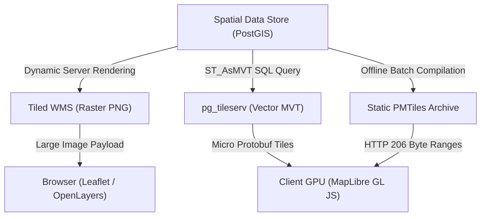
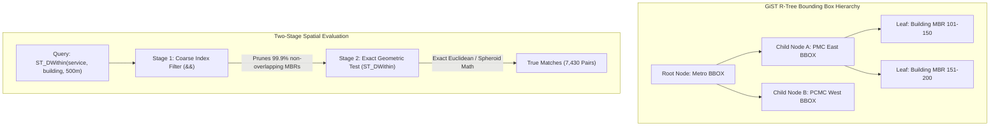
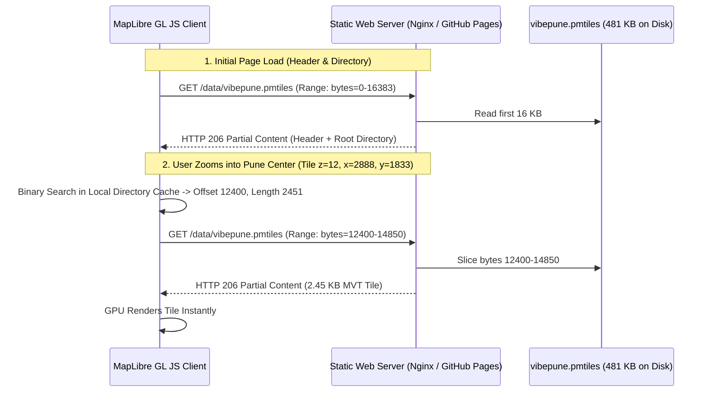

# Study Note S2: Web Map Tiling Paradigms, PostGIS Spatial Indexing, and PMTiles Architecture

**Author:** VibePune WebGIS Engineering Team  
**Module:** High-Performance Vector Delivery & Spatial Database Optimization  
**Project:** VibePune (PMC + PCMC Study Area)

---

## 1. Executive Overview

Modern WebGIS architectures must deliver fluid user experiences across millions of geographic features while minimizing network payload and database computational overhead. This study note analyzes the evolution from **raster map tiles** to **Mapbox Vector Tiles (MVT)**, the internal mechanics of **GiST R-Tree spatial indexing** in PostGIS, query execution plan optimizations (contrasting `ST_DWithin` with `ST_Distance`), and the emerging paradigm of **Cloud-Optimized PMTiles** powered by HTTP Range requests.

---

## 2. Web Map Tiling Paradigms: Raster vs Vector

The slippy-map quadtree tiling model, introduced by early web mapping engines, discretizes the surface of the Earth into a pyramid of zoom levels $z \in [0, 22]$. At zoom level $z$, the globe is partitioned into $2^z \times 2^z$ square tiles of $256 \times 256$ pixels.



### 2.1 Raster Tiling (Tiled WMS / Pre-rendered PNGs)
- **Mechanics:** The GIS server (e.g., GeoServer) rasterizes vector features into static 256px or 512px image tiles.
- **Advantages:**
  - Complete client compatibility: Any browser can display an `` tag without WebGL support.
  - Cartographic complexity is resolved on the server; the client does not parse coordinate vertices.
- **Critical Limitations:**
  - **Bandwidth Overhead:** Continuous pan/zoom triggers transfers of uncompressed or losslessly compressed PNGs ($50\text{–}150\text{ KB}$ per tile).
  - **Static Cartography:** Labels, colors, and line widths are permanently baked into pixels; hover effects, dynamic filtering, and client-side styling are impossible without roundtrip server calls.
  - **Pixelation at Fractional Zoom:** Zooming between integer zoom levels produces blurry or distorted raster imagery.

### 2.2 Vector Tiling (Mapbox Vector Tiles / MVT)
- **Mechanics:** Vector geometries are clipped to tile boundaries, simplified using algorithms such as Douglas-Peucker according to zoom scale, and serialized into binary Protocol Buffers (`.pbf`).
- **Standard:** The Mapbox Vector Tile specification encodes geometric primitives (Point, LineString, Polygon) as integer screen coordinates on a high-resolution grid (typically $4096 \times 4096$ units per tile).
- **Client Rendering (MapLibre GL JS):** The client web browser decodes the Protocol Buffer and utilizes WebGL/WebGPU shaders to render vectors directly on the client's graphics card at a steady 60 frames per second (FPS).
- **Advantages:**
  - **Dynamic Client Styling:** A single vector tile stream can be re-styled on the fly (e.g., dark mode, heatmaps, interactive choropleths based on user-selected attributes) with zero server requests.
  - **Bandwidth Efficiency:** Highly optimized binary encoding reduces payload sizes dramatically at local scales (e.g., down to $6.74\text{ KB}$ at Zoom 16 in Pune).
  - **Interactive Attribute Inspection:** Vector tiles retain underlying feature properties, enabling instantaneous client-side popups without querying the database backend.

---

## 3. PostGIS Spatial Indexing Mechanics: GiST and the R-Tree

Relational database B-Tree indexes rely on strict scalar ordering ($A < B < C$), making them incapable of indexing multi-dimensional spatial geometries. PostGIS overcomes this using the **Generalized Search Tree (GiST)** framework implementing an **R-Tree** (Rectangle Tree) index.



### 3.1 Minimum Bounding Rectangles (MBR)
- For every geometry, PostGIS extracts its 2D Minimum Bounding Box:
  $$\text{MBR} = [x_{\min}, y_{\min}, x_{\max}, y_{\max}]$$
- In GiST indexes, bounding boxes of nearby features are hierarchically aggregated into parent bounding boxes up to a single root node.
- When searching for features within a geographic region, the database traverses the R-Tree from the root downward. If a query box does not intersect a parent node's bounding box, the entire branch of thousands of geometries is instantly pruned from evaluation ($O(\log N)$ search complexity).

### 3.2 The Two-Stage Evaluation Pipeline
PostGIS spatial functions evaluate geometry in two distinct stages:
1. **Stage 1 — The Index Filter (Coarse Test):**
   - Evaluates the bounding-box intersection operator: `geom_a && geom_b`.
   - Operates entirely within the in-memory GiST index pages without loading bulky coordinate vertex arrays from disk.
   - Quickly discards the vast majority of non-candidate geometry pairs.
2. **Stage 2 — The Exact Calculation (Refinement Test):**
   - Loads the exact point, line, and polygon vertex sequences from table heap pages.
   - Executes precise planar or ellipsoidal intersection algorithms (e.g., Sutherland-Hodgman polygon clipping, point-in-polygon ray casting).

---

## 4. Query Planner Analysis: `ST_DWithin` vs `ST_Distance`

A classic pitfall in spatial data engineering is the syntactical choice between `ST_DWithin` and `ST_Distance < threshold`. While mathematically equivalent, they produce fundamentally different query plans.

### 4.1 Empirical Benchmark (Pune Services & Buildings)
- **Target Query:** Identify all building footprints within $500\text{ m}$ of each of the 5,775 registered services across Pune and Pimpri-Chinchwad.
- **Tables:** `services` ($N = 5,775$ points), `buildings` ($M = 1,508$ polygons). Total potential Cartesian comparisons:
  $$N \times M = 5,775 \times 1,508 = \mathbf{8,708,700\text{ pairs}}$$

### 4.2 Query Plan Execution Comparison (EXPLAIN ANALYZE)

| Execution Configuration | SQL Formulation | Query Plan Scan Nodes | Execution Time | Performance Factor |
|---|---|---|---|---|
| **Case 1: No Index** | `ST_DWithin(s.geom_utm, b.geom_utm, 500)` (GiST index dropped) | Nested Loop + `Seq Scan on buildings` (8.7M evaluations) | **4,932.1 ms** | 1.0× (Baseline) |
| **Case 2: With GiST Index** | `ST_DWithin(s.geom_utm, b.geom_utm, 500)` (GiST index active) | Nested Loop + `Bitmap Index Scan on buildings_geom_utm_gist` | **162.2 ms** | **30.4× speedup** |
| **Case 3: Inefficient Distance** | `ST_Distance(s.geom_utm, b.geom_utm) < 500` (GiST index active) | Nested Loop + `Seq Scan on buildings` (Index Ignored) | **5,566.4 ms** | 0.88× (Slowest) |

### 4.3 Why `ST_Distance` Fails to Use Spatial Indexes
- **`ST_DWithin(geom_a, geom_b, distance)`** is an index-aware function. Internally, PostGIS rewrites this function to automatically inject the bounding-box operator:
  $$\text{geom\_a } \&\& \text{ ST\_Expand(geom\_b, distance)}$$
  This triggers a `Bitmap Index Scan` on the GiST index, narrowing the 8.7 million Cartesian pairs down to a few thousand overlapping bounding boxes before performing exact geometric distance checks.
- **`ST_Distance(geom_a, geom_b) < 500`** is an arbitrary scalar comparison. The PostgreSQL query optimizer cannot infer that the scalar result of a function evaluation relates to the multidimensional GiST index. Consequently, the planner is forced to execute a brute-force `Seq Scan`, loading and calculating the exact point-to-polygon distance for all **8,708,700 pairs** sequentially.

---

## 5. Cloud-Optimized PMTiles (ProtoMap Tiles)

The latest evolution in web mapping distribution is **PMTiles (Version 3)**, a single-file archive format for vector and raster map tiles designed specifically for serverless cloud hosting.



### 5.1 Internal Anatomy of a PMTiles File
A PMTiles v3 container consists of four contiguous binary sections:
1. **Header (127 bytes):** Magic bytes (`PMTiles`), version (v3), tile type (MVT), compression type (GZIP), bounding box limits ($[\text{min\_lon}, \text{min\_lat}, \text{max\_lon}, \text{max\_lat}]$), min/max zoom, and root directory offsets.
2. **Root Directory:** Compact lookup table mapping TileIDs to byte offsets and lengths within the file. TileIDs are ordered along a space-filling **Hilbert curve**, ensuring that geographically adjacent tiles are clustered together in physical byte sequence.
3. **JSON Metadata:** Layer schemas, attribute descriptors, and attribution strings.
4. **Tile Data Payload:** Raw binary compressed MVT protobuf byte streams.

### 5.2 Serverless Slicing via HTTP Range Requests (206 Partial Content)
- Traditional map servers require an active application runtime (e.g., Python FastAPI, Go `pg_tileserv`, or Java GeoServer) running 24/7 to query databases and serve tiles.
- **PMTiles eliminates the server runtime entirely.** The web client (MapLibre with the `pmtiles` protocol plugin) inspects the root directory cached in browser memory, calculates the exact byte offset of the required tile, and issues an HTTP `Range` request:
  ```http
  GET /data/vibepune.pmtiles HTTP/2
  Range: bytes=12400-14850
  ```
- Any standard static web server or Content Delivery Network (Nginx, Amazon S3, Cloudflare, GitHub Pages) responds with `HTTP 206 Partial Content`, transferring only the requested **2.45 KB** slice.
- **Architectural Advantage:** Infinitely scalable, zero database connection limits, impervious to DDoS attacks, and costing \$0/month on static cloud hosting.

---

## 6. Synthesis: Tiling and Indexing Strategy Matrix

| Metric | Tiled WMS (GeoServer) | Dynamic MVT (`pg_tileserv`) | Static PMTiles (Edge CDN) |
|---|---|---|---|
| **Server Requirements** | Heavy Java VM (GeoServer) | Lightweight Go binary + PostGIS | Zero (Static HTTP Server / CDN) |
| **Data Freshness** | Immediate | Immediate (Direct SQL) | Static Snapshot (Build-time) |
| **Bandwidth (Z16 Street View)** | 60.31 KB (PNG) | **6.74 KB** (MVT Protobuf) | **2.45 KB** (Partial Range MVT) |
| **Client Rendering** | 2D Canvas / DOM Image | WebGL GPU Vector Engine | WebGL GPU Vector Engine |
| **Ideal Use Case** | Continuous raster surfaces (DEM) | Live transactional PostGIS layers | Public dissemination, offline apps |
