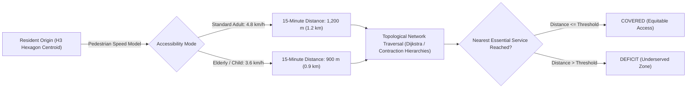
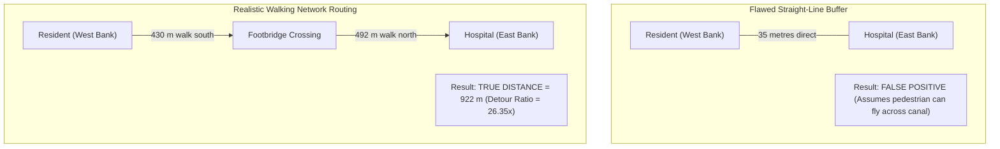
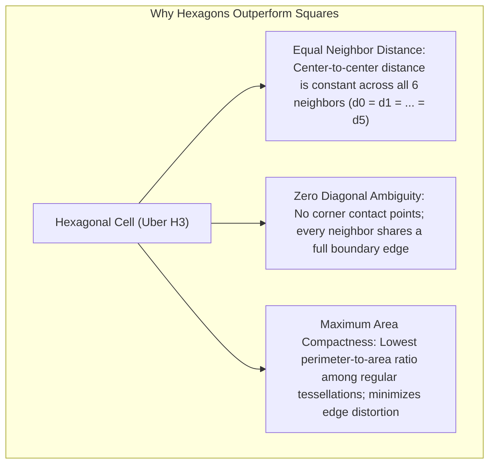

# Study Note S3: Urban Accessibility Modeling, Isochrone Algorithms, and Hexagonal Spatial Analysis (H3)

**Author:** VibePune WebGIS Engineering Team  
**Module:** Spatial Analytics, Network Accessibility & Discrete Global Grid Systems  
**Project:** VibePune (PMC + PCMC Study Area)

---

## 1. Executive Overview

Urban accessibility analysis evaluates the spatial equity and temporal convenience with which citizens reach essential social infrastructure (healthcare, education, transit, fresh food, and civic administration). This study note investigates the theoretical framework of the **15-Minute City**, the algorithmic differences between **topological street-network routing** and **Euclidean buffer approximations**, the mathematics of **Discrete Global Grid Systems (DGGS)** via Uber's **H3 hexagonal indexing**, the **Modifiable Areal Unit Problem (MAUP)**, and demographic vulnerability modeling under reduced mobility scenarios.

---

## 2. Theoretical Framework: The 15-Minute City Paradigm

Introduced by urban scholar Carlos Moreno, the **15-Minute City** posits that urban residents should be capable of fulfilling their core daily human needs (living, working, supplying, caring, learning, and enjoying) within a 15-minute walk or bicycle ride from their doorsteps.

### 2.1 Pedestrian Velocity Modeling
Human walking velocity is non-uniform and varies systematically with age, physical ability, street gradient, and sidewalk quality:
- **Standard Adult Pedestrian Model:**
  $$v_{\text{adult}} = 4.8\text{ km/h} = \frac{4800\text{ m}}{60\text{ min}} = \mathbf{80\text{ m/min}}$$
  $$\text{Distance Threshold (15 min)} = 80\text{ m/min} \times 15\text{ min} = \mathbf{1,200\text{ m} = 1.2\text{ km}}$$
- **Vulnerable / Elderly Citizen Model:**
  $$v_{\text{elderly}} = 3.6\text{ km/h} = \frac{3600\text{ m}}{60\text{ min}} = \mathbf{60\text{ m/min}}$$
  $$\text{Distance Threshold (15 min)} = 60\text{ m/min} \times 15\text{ min} = \mathbf{900\text{ m} = 0.9\text{ km}}$$
- **Urban Context:** For high-density municipal corporations such as Pune (PMC) and Pimpri-Chinchwad (PCMC), the 15-minute ($1,200\text{ m}$) benchmark serves as the primary urban planning standard. In outer peri-urban or rural talukas, a 30-minute ($2,400\text{ m}$) threshold is commonly applied.

---

## 3. Network Routing vs Straight-Line Buffers: The Physical Barrier Problem

A foundational error in urban planning is the reliance on Euclidean (straight-line) circular buffers ("as the crow flies") to measure access to public services.

### 3.1 Mathematical Modeling of Topological Street Graphs
A pedestrian walking network is modeled as a directed, weighted spatial graph:
$$G = (V, E, W)$$
- **Vertices ($V$):** Street intersections, pathway forks, and dead ends.
- **Edges ($E$):** Navigable pedestrian paths, sidewalks, footways, and residential roads.
- **Edge Weights ($W$):** True physical length in metres, impedance penalties for traffic signals, and slope resistance.
- **Topological Isochrones:** Generated via Dijkstra's shortest-path algorithm or Contraction Hierarchies, expanding outward from an origin along traversable graph edges until the cumulative weight equals the target threshold ($1,200\text{ m}$).

### 3.2 The Detour Factor and Empirical Barrier Evidence (Pune Case Study)
The **Detour Ratio** measures how much farther a pedestrian must walk along the real street network compared to the Euclidean distance:
$$\text{Detour Ratio} = \frac{\text{Distance}_{\text{network}}}{\text{Distance}_{\text{straight}}}$$

In the empirical audit of 30 randomly generated points across Pune (Seed 42):
- **46.7% (14 out of 30 points)** reached a *completely different* nearest service when walking along the actual street network compared to Euclidean proximity.
- **Median Detour Ratio:** **1.95×** (pedestrians walk almost twice as far as straight-line distance suggests).
- **The Worst-Case Physical Barrier (Point #9 near Mutha Canal, Sinhagad Road):**
  - Point Coordinates: $18.49160^\circ\text{ N}, 73.83446^\circ\text{ E}$.
  - Straight-Line Nearest Service: "Apollo Clinic" at direct distance **35.0 metres**.
  - Network Walking Distance: **922.4 metres** to "Matoshree Hospital".
  - **Detour Ratio:** **26.35×**!
  - **Underlying Cause:** The high-walled **Mutha Right Bank Canal** acts as an impermeable physical barrier without pedestrian crossings at that coordinate. The pedestrian is forced to walk $430\text{ m}$ south to the nearest arterial bridge, cross, and backtrack $492\text{ m}$ north along the opposite embankment.
- **Urban Planning Implication:** Straight-line buffer analyses overestimate service accessibility by ignoring impermeable urban barriers (railway corridors, expressways, rivers, industrial compounds, and canals).

---

## 4. Discrete Global Grid Systems (DGGS): Uber H3 Architecture

To perform rigorous spatial accounting across irregular municipal boundaries without boundary alignment artifacts, modern spatial data pipelines use **Discrete Global Grid Systems (DGGS)**.

### 4.1 Mathematical Advantages of Hexagonal Tessellation
Among the three regular polygons that can tessellate a 2D Euclidean plane (triangles, squares, and hexagons), hexagons possess unique topological characteristics:
1. **Uniform Neighbor Adjacency:** In a square grid, an interior cell has two distinct classes of neighbors: 4 orthogonal neighbors sharing an edge (distance $d$) and 4 diagonal neighbors sharing only a vertex (distance $d\sqrt{2} \approx 1.414d$). This causes severe directional bias in spatial diffusion and buffer modeling. In a hexagonal grid, every cell has exactly 6 neighbors, each sharing an edge of identical length and separated by an identical center-to-center distance:
   $$d_i = \sqrt{3} \cdot r \quad (\forall i \in \{1, 2, ..., 6\})$$
2. **Optimal Circular Compactness:** The regular hexagon minimizes the perimeter for a given area, approximating a circle closer than triangles or squares. This reduces edge-effect errors when intersecting with arbitrary administrative zones.

### 4.2 H3 Hierarchical Structure: Resolution 8 vs Resolution 9
Uber H3 maps the surface of an icosahedron onto the Earth using an Aperture 7 hierarchical decomposition:

| Metric | H3 Resolution 8 (Ward Scale) | H3 Resolution 9 (Neighborhood Scale) |
|---|---|---|
| **Average Cell Area** | $0.7373\text{ km}^2$ ($73.7\text{ hectares}$) | $0.1053\text{ km}^2$ ($10.5\text{ hectares}$) |
| **Hexagon Edge Length** | $461.4\text{ m}$ | $174.4\text{ m}$ |
| **Cells in Pune PMC+PCMC** | **618 cells** | **4,360 cells** |
| **Spatial Granularity** | Macro-district / Ward planning | Street block / micro-neighborhood |

---

## 5. The Modifiable Areal Unit Problem (MAUP)

The Modifiable Areal Unit Problem (MAUP) is a pervasive statistical bias that occurs when point-based geographic phenomena are aggregated into continuous spatial zones. It manifests in two distinct forms:

### 5.1 The Scale Effect (Res 8 vs Res 9)
The Scale Effect occurs when the spatial aggregation unit changes in size while maintaining the same study area:
- At **H3 Resolution 8** ($73.7\text{ hectares}$/cell), hexagon centroids are spaced $\sim 800\text{ m}$ apart. Large peripheral cells overlap both dense urban fabric and steep hillsides. Coarse centroid routing masks localized pockets of service access, classifying **2.22% of the population (7,546 residents)** as underserved.
- At **H3 Resolution 9** ($10.5\text{ hectares}$/cell), fine-grained discretization isolates localized clusters of buildings. Only **0.80% of the population (2,810 residents)** is classified as underserved.
- **Conclusion:** Aggregating at coarser scales can artificially inflate perceived service deficits by over $270\%$ due to centroid-to-boundary distance artifacts.

### 5.2 The Zoning Effect (Administrative vs Hexagonal)
The Zoning Effect occurs when the shape and orientation of the aggregation boundaries are modified while holding the scale roughly constant:
- **Municipal Boundaries Aggregation:** Aggregating Pune into statutory jurisdictions reveals a stark administrative dichotomy:
  - **PCMC:** **0.00% underserved** (100% of 118,976 residents within 15-minute walking access).
  - **PMC:** **1.21% underserved** (2,810 residents outside the 15-minute boundary).
- When analyzed using arbitrary administrative wards, internal pockets of deprivation in southern Katraj are averaged out by affluent, well-served neighborhoods nearby. Independent hexagonal tessellation (H3) eliminates political gerrymandering and reveals true spatial variance.

---

## 6. Population Proxy Modeling and Demographic Vulnerability

### 6.1 Building Footprint Population Proxy
In developing metropolitan regions where micro-census enumeration block data is proprietary or outdated, building footprints provide a high-resolution, empirical proxy for resident density:
$$\text{Population}_{\text{proxy}} = \frac{\sum \text{Building Footprint Area } (\text{m}^2)}{30\text{ m}^2/\text{capita}}$$
- Incorporates gross residential floor space standards for urban Maharashtra ($30\text{ m}^2$ per capita including common circulation and wall thicknesses).
- Automatically assigns zero population to barren hillsides, agricultural land, and water reservoirs.

### 6.2 Demographic Vulnerability Analysis: The Elderly Scenario (Q8)
To evaluate social equity, the network walking model was recomputed under an **elderly mobility scenario** ($v = 3.6\text{ km/h}$, 15-minute threshold $= 900\text{ m}$):

| Scenario | Walking Speed | 15-Min Distance | Covered Population | Population Coverage % |
|---|---|---|---|---|
| **Standard Adult** | $4.8\text{ km/h}$ | $1,200\text{ m}$ | 348,880 residents | **99.20%** |
| **Elderly Citizen** | $3.6\text{ km/h}$ | $900\text{ m}$ | 345,611 residents | **98.27%** |
| **Vulnerability Gap** | $-1.2\text{ km/h}$ | $-300\text{ m}$ | **3,269 residents** | **0.93% points lost** |

- **Geographic Hotspot of Vulnerability:** H3 cell `896088cd2abffff` in the southern Katraj / Ambegaon foothills ($18.43555^\circ\text{ N}, 73.88006^\circ\text{ E}$).
- The walking distance to the nearest healthcare/pharmacy service is **1,169.5 metres**:
  - A healthy adult walks this in **14.6 minutes** ($\le 15\text{ min} \rightarrow$ Covered).
  - An elderly resident walks this in **19.5 minutes** ($> 15\text{ min} \rightarrow$ **Unserved**).
- **Policy Recommendation:** Prioritize mobile medical dispensaries and primary healthcare sub-centers in southern PMC perimeter zones to eliminate this 3,269-resident vulnerability gap.
