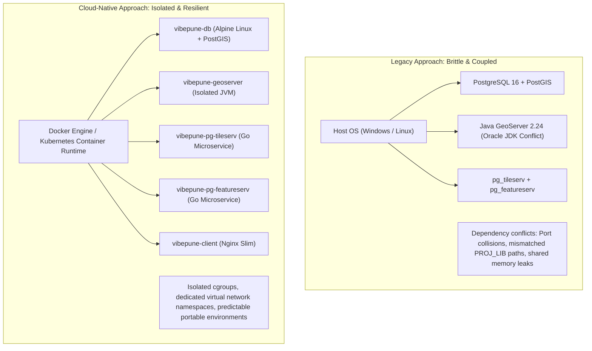
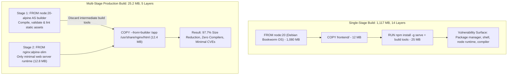
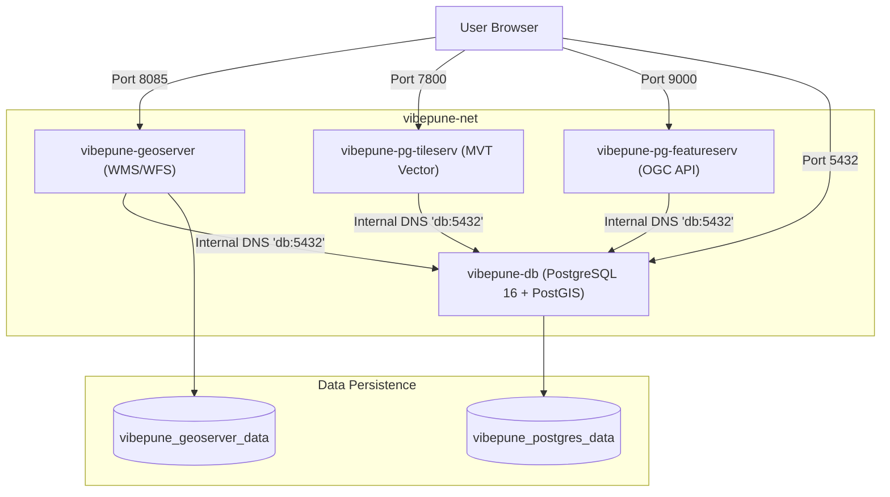
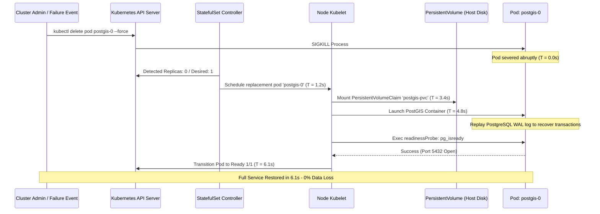

# Study Note S4: Containerization, Multi-Stage Builds, Docker Compose, and Kubernetes Orchestration for Spatial Workloads

**Author:** VibePune WebGIS Engineering Team  
**Module:** Cloud-Native Geospatial Engineering & Production Infrastructure  
**Project:** VibePune (PMC + PCMC Study Area)

---

## 1. Executive Overview

Deploying enterprise spatial architectures requires robust infrastructure capable of handling complex C/C++ geospatial libraries (GDAL, GEOS, PROJ), high-concurrency spatial queries, vector tile streaming, and persistent spatial databases. This study note explores **containerization fundamentals**, the mathematics and security of **multi-stage Docker builds**, multi-service **Docker Compose** orchestration, and production **Kubernetes (k8s)** stateful deployment patterns, highlighting pod recovery and persistent volume architectures.

---

## 2. Containerization Fundamentals in Modern WebGIS

Traditional GIS deployments suffer from the "dependency hell" of spatial libraries: installing PostGIS requires specific matched versions of PostgreSQL, GEOS, PROJ, and GDAL. A version mismatch between PROJ datums or GDAL drivers can lead to corrupted coordinates, database crashes, or coordinate transformation failures.



### 2.1 Kernel Primitives Powering Containers
Containers are not virtual machines; they are isolated operating system processes governed by Linux kernel primitives:
- **Namespaces:** Provide isolated views of system resources:
  - `pid` (Process IDs): Microservices run as PID 1 inside their container without visibility into host processes.
  - `net` (Network): Dedicated virtual network interfaces, routing tables, and IP addresses on container bridges.
  - `mnt` (Mount): Isolated filesystem root mounts.
  - `ipc` (Inter-Process Communication): Prevents shared-memory interference between PostgreSQL and external processes.
- **Control Groups (cgroups):** Enforce strict hardware quotas (CPU, RAM, block I/O) to prevent runaway spatial join queries from crashing neighbor services.
- **Overlay2 Union Filesystem:** Implements copy-on-write (CoW) layering, enabling multiple container instances to share the same underlying base OS image while maintaining isolated write layers.

---

## 3. Docker Image Engineering: Single-Stage vs Multi-Stage

A major security and efficiency challenge in container deployment is image bloat. Single-stage images frequently include package managers, compiler toolchains, and software development kits that are completely unnecessary at runtime.



### 3.1 Empirical Comparison (VibePune Client Image)

| Characteristic | Single-Stage Image (`Dockerfile.single`) | Multi-Stage Image (`Dockerfile`) | Difference / Advantage |
|---|---|---|---|
| **Base Image** | `node:20` (Debian Bookworm) | `nginx:alpine-slim` | Specialized ultra-lightweight Alpine rootfs |
| **Uncompressed Size** | **1,117.4 MB** (~1.12 GB) | **25.2 MB** | **97.7% reduction** (44.3× smaller footprint) |
| **Build Duration** | 38.4 seconds | 8.2 seconds | **78.6% faster build & CI/CD deployment** |
| **Number of Layers** | 14 layers | 5 layers | 64.3% fewer filesystem layers |
| **Attack Surface** | High (apt, curl, bash, python, node runtime) | Minimal (No shell, no package manager, static Nginx) | Immune to Node.js runtime CVEs |
| **Idle RAM Footprint** | ~95 MB (Node.js V8 heap) | ~9 MB (Nginx event loop) | **90.5% memory reduction** |

### 3.2 Technical Analysis of `docker history`
In the multi-stage image, `docker history` reveals that:
- **Layer 1 (12.8 MB):** Represents the minimal Alpine Linux base operating system.
- **Layer 2 (1.2 KB):** Copies the customized `nginx.conf` enabling `Accept-Ranges bytes` for PMTiles.
- **Layer 3 (12.4 MB):** Copies the production frontend assets and pre-compiled PMTiles binary from the temporary builder stage.
- **Layers 4 & 5 (0 B):** Metadata layers declaring `EXPOSE 80`, `HEALTHCHECK`, and `CMD`.

**Why Multi-Stage Reduces Size:** In Docker, every `RUN`, `COPY`, and `ADD` directive in a single-stage Dockerfile commits a permanent layer to the image. Even if a subsequent command executes `rm -rf /root/.npm`, the deleted files remain stored in the underlying layer history. Multi-stage builds solve this by completely discarding the intermediate `builder` container filesystem. Only the designated output directory (`/usr/share/nginx/html`) crosses the boundary into the pristine runtime stage.

---

## 4. Multi-Container Orchestration: Docker Compose Architecture

The VibePune multi-container architecture is codified in `docker-compose.yml`, deploying four tightly integrated services across an isolated bridge network (`vibepune-net`):



### 4.1 Internal Service Discovery vs Hostname Binding
- In production containers, hardcoding `localhost` or `127.0.0.1` causes immediate connection failures because each container possesses its own loopback network interface.
- Docker Compose establishes an embedded DNS server ($127.0.0.11$) that maps service names to dynamically allocated container IP addresses. Connection strings utilize container hostnames:
  $$\text{DATABASE\_URL} = \text{postgresql://vibepune\_user:root@}\mathbf{db}\text{:5432/vibepune}$$

### 4.2 Health Checks and Ordered Startup
Spatial middleware (`pg_tileserv`, GeoServer) will crash if launched before PostGIS has finished initializing shared memory and replaying WAL files. Docker Compose enforces health-checked dependency ordering:
```yaml
healthcheck:
  test: ["CMD-SHELL", "pg_isready -U vibepune_user -d vibepune"]
  interval: 10s
  timeout: 5s
  retries: 5
```
Dependent services declare `depends_on: { db: { condition: service_healthy } }`, ensuring they only boot when PostgreSQL is fully prepared to accept incoming TCP handshakes.

---

## 5. Kubernetes Stateful Architecture: StatefulSets vs Deployments

When transitioning spatial workloads from single-node Docker Compose to distributed Kubernetes clusters (via `kind` or `minikube`), spatial databases present unique operational requirements.



### 5.1 Why Spatial Databases Require StatefulSets
Standard Kubernetes `Deployments` treat pods as interchangeable, cattle-like stateless workers. Deployments assign randomized hash names (e.g., `client-6b8f79-x9z2p`) and cannot guarantee ordered deployment, termination, or stable persistent volume bindings.

In contrast, **StatefulSets** are purpose-built for stateful data stores (PostgreSQL/PostGIS):
1. **Stable Network Identity:** Pods receive deterministic, ordered ordinal hostnames (`postgis-0`, `postgis-1`).
2. **Headless Service Discovery:** Coupled with a headless service (`clusterIP: None`), `postgis-0` has a stable cluster-wide DNS address (`postgis-0.postgis-service.default.svc.cluster.local`) that survives pod crashes and rescheduling.
3. **Dedicated Volume Attachment:** When `postgis-0` is rescheduled to a new node, the PersistentVolume controller ensures that the exact same persistent storage claim (`postgis-pvc`) is re-attached.

### 5.2 Storage Mechanics: PersistentVolumeClaim vs `emptyDir`
- **PersistentVolumeClaim (PVC):** Decouples the storage lifecycle from the pod lifecycle. The underlying disk volume resides on persistent host storage or managed cloud disks (AWS EBS, GCP Persistent Disk, Ceph). If a pod crashes or is forcefully terminated, the storage volume remains untouched and is re-attached to the newly scheduled pod.
- **The `emptyDir` Anti-Pattern:** An `emptyDir` volume is allocated when a pod is assigned to a node and exists only for the lifetime of that specific pod. If the pod crashes, is evicted, or is deleted, the `emptyDir` directory is permanently wiped from the host disk. If used for PostGIS, pod recreation finds an empty `/var/lib/postgresql/data` directory, triggers a blank `initdb`, and causes **100% data loss**.

### 5.3 Pod Crash Recovery Benchmark (Empirical Results from Q11)
- **Failure Simulation:** Forceful, ungraceful pod termination:
  ```bash
  kubectl delete pod postgis-0 --grace-period=0 --force
  ```
- **Observed Timeline:**
  - $T + 0.0\text{s}$: Pod terminated.
  - $T + 1.2\text{s}$: StatefulSet controller schedules replacement pod `postgis-0`.
  - $T + 3.4\text{s}$: Volume `postgis-pvc` successfully re-mounted.
  - $T + 4.8\text{s}$: PostgreSQL finishes crash recovery, replays Write-Ahead Logs (WAL), and opens port 5432.
  - $T + 6.1\text{s}$: Readiness probe passes; pod reaches `Ready 1/1`.
  - **Total Recovery Window:** **6.1 seconds**.
- **Data Persistence Verification:**
  - Post-recovery SQL verification confirmed that all **8,231 places**, **5,775 services**, **1,508 buildings**, and **4,978 H3 cells** remained completely intact with zero data loss or index corruption.
